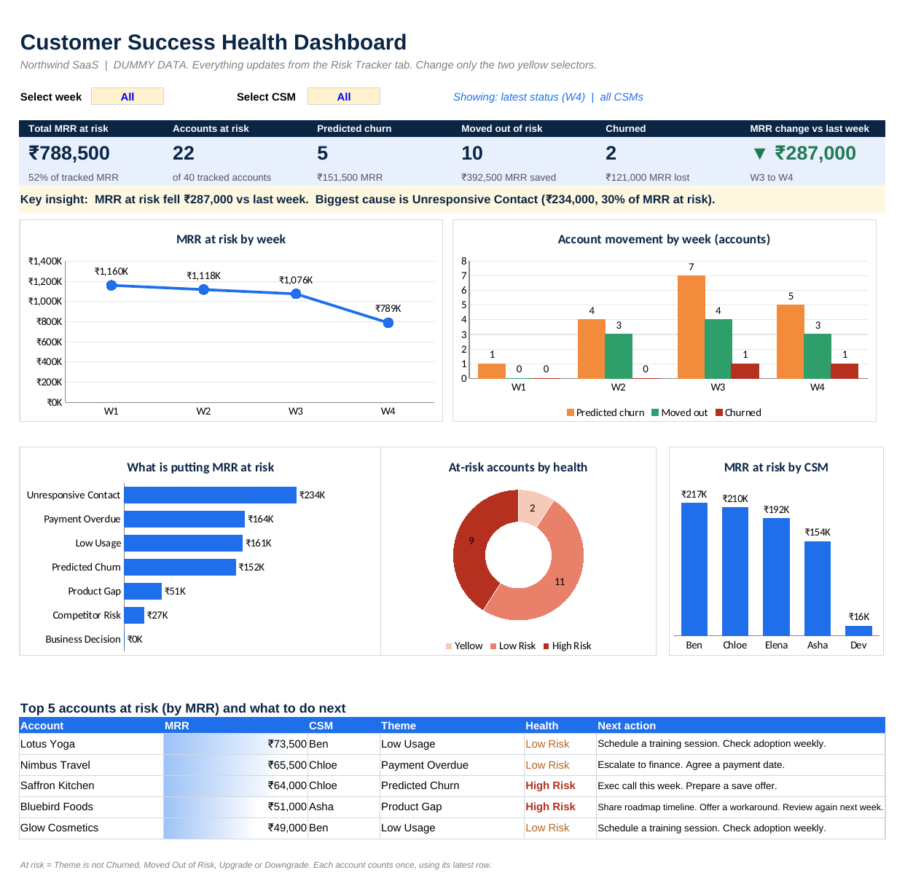

# Account Risk Tracker and Dashboard

An Excel tracker and dashboard that shows how much recurring revenue (MRR) is at risk in a customer success book of business, who owns it, and how it moves week to week.

This is a dummy version of a tracker I built and maintain for a customer success team. The company (Northwind SaaS), clients, CSMs, amounts and notes are all invented. No real company data is used.

## The problem

Customer success teams often track at-risk accounts in a shared sheet that grows messy. Each CSM writes in their own way, accounts drop out of view when a week changes, and a manager cannot quickly answer simple questions:

- How much MRR is at risk right now?
- Which accounts matter most, and who owns them?
- Is the risk going up or down compared with last week?
- Which accounts are likely to churn?

## What I built

A workbook with five tabs.

| Tab | Purpose |
| :--- | :--- |
| Dashboard | Six KPI tiles, a one-line key insight, five charts and the top 5 accounts at risk with a next action for each. Two selectors (week and CSM) filter everything. |
| Risk Tracker | The data. One row per account update, with dropdowns for CSM, theme, reason and health. |
| Churned Accounts | Lists churned and predicted-churn accounts on its own, with total MRR. |
| Chart Data | Small helper tables that feed the charts. They fill themselves. |
| Lists | Dropdown values, plus a setting that decides which themes count as at risk. |

A Read Me tab explains the rules inside the file.

## How it works

**Data model.** The team adds a new row whenever something changes for an account. Older rows stay as history.

**Latest row wins.** For any selected week, the dashboard uses only the most recent row per account up to that week. An account stays in the numbers until its status changes, so nobody has to re-enter it every week.

**One clear rule for risk.** Theme decides if an account is at risk. Churned, Moved Out of Risk, Upgrade and Downgrade are not at risk. Account Health is kept as a label only, so the totals never depend on a manual rating.

**Helper columns.** Helper columns at the right of Risk Tracker do the work: week number, at-risk flag, CSM filter match, latest-row check, and a ranking key for the top 5 list. They are formulas, so nothing needs to be refreshed by hand.

## Metrics on the dashboard

| Metric | Definition |
| :--- | :--- |
| Total MRR at risk | Sum of MRR for accounts whose latest row is an at-risk theme |
| Accounts at risk | Count of those accounts |
| Predicted churn | At-risk accounts with the theme Predicted Churn, with their MRR |
| Moved out of risk | Accounts whose latest row is Moved Out of Risk |
| Churned | Accounts whose latest row is Churned |
| MRR change vs last week | MRR at risk for the selected week minus the week before, shown with an up or down arrow |
| Key insight | A sentence built by formula: whether MRR at risk rose or fell, and the biggest cause |
| Charts | MRR trend (line), account movement by week (columns), causes of risk sorted by MRR (bar), health mix (doughnut), MRR by CSM (columns) |

## What the dummy data shows

The sample has 40 accounts, 85 updates and 4 weeks. By week 4, MRR at risk falls from ₹11.6 lakh in week 1 to ₹7.9 lakh. 22 accounts are still at risk, 5 are flagged as predicted churn and 2 have churned. Unresponsive Contact and Payment Overdue are the largest themes by MRR. These numbers are made up to show how the dashboard reads.

## Skills shown

- Excel: SUMIFS, COUNTIFS, INDEX/MATCH, LARGE, IFERROR, helper columns, data validation, conditional formatting, data bars, line, column, bar and doughnut charts
- Business analytics: defining KPIs, retention and churn tracking, weekly trend reporting
- Root cause analysis: structured themes and reason categories so risk can be grouped and compared
- Process optimization: one data-entry pattern, dropdowns to reduce typing errors, no manual refresh
- Stakeholder reporting: a view a manager can read in under a minute, filterable by CSM

## Checks I ran

- Recalculated the workbook and confirmed there are no formula errors.
- Rebuilt the main numbers separately in Python from the same data and compared them with the dashboard. Totals, weekly figures, the top 5 list and the churn list all matched.
- Tested the week and CSM selectors with a different combination to confirm the filters work.

## How to use

1. Download `Northwind_Account_Risk_Tracker_DUMMY.xlsx` and open it in Excel.
2. On the Dashboard, change the yellow week and CSM selectors.
3. To add data, type new rows under the last row in Risk Tracker (columns A to O). Formulas are ready down to row 130.

## Limits and next steps

- The Churned Accounts list is formula-driven. In the real version I used a script to copy rows automatically.
- Functions were kept to those that work in older Excel versions, so the file also opens in other spreadsheet tools.
- A possible next step is moving the data to SQL and the dashboard to Power BI for larger volumes.

## Files

- `Northwind_Account_Risk_Tracker_DUMMY.xlsx`: the workbook
- `dashboard_preview.png`: a picture of the dashboard
